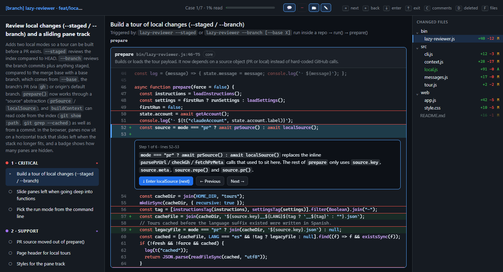

# Lazy Reviewer

An AI-guided walk through a GitHub Pull Request, or through your local changes before they are a PR. It follows the use cases in order of importance, opens a pane for each function the flow enters, and explains every span of code by quoting the real code.

The explanations are written in the context of what the project does, not just what each line computes. The tour opens with what the affected part of the product is for, each use case starts from what triggers it (an endpoint, a command, a screen) and each step says what it means for that flow: which user action, which data, which business rule. That makes it useful when you don't know the codebase: reviewing a PR in a repo that is new to you, onboarding, or reading a teammate's change in an area you never touched.



*Lazy Reviewer touring its own `feat/local-modes` branch (`lazy-reviewer --branch --base main`).*

It runs locally: it uses **your** GitHub login (`gh`) and **your** Claude account. There is no server in between.

## Quick start
```sh
git clone https://github.com/CampaUTN/lazy-reviewer.git
cd lazy-reviewer
npm install
npm link                      # makes the `lazy-reviewer` command available

lazy-reviewer config          # optional: pick mode, layers, language and instructions
lazy-reviewer https://github.com/<owner>/<repo>/pull/<n>
```
It opens `http://localhost:4321` with the tour.

## Local changes (no PR)
Run it from inside a repo:
```sh
lazy-reviewer --staged                 # what you staged with `git add`, compared to HEAD
lazy-reviewer --branch                 # the current branch (commits + staged) compared to its base
lazy-reviewer --branch --base develop  # ...compared to a branch you choose
lazy-reviewer --staged --repo ../api   # another repo instead of the current folder
```
With `--branch`, the base is the base of the branch's open PR (looked up with `gh`); if there is none, origin's default branch. It fetches `origin/<base>` first and compares from the merge base, so only your branch's work counts: its commits plus whatever is staged on top (a branch with no commits yet works too). Unstaged changes are not included: `git add` them first. The commit messages play the role of the PR description.

Local modes read your checkout directly (no clone) and don't need `gh` unless `--branch` has to find the PR's base. Tours are cached by the branch commits and the staged content: change either and the tour is rebuilt.

## Requirements
- Node 20+
- GitHub CLI signed in: `gh auth login`
- One of these two ways to call Claude:
  - **Claude Code (default)**: the `claude` CLI, signed in (uses your claude.ai plan, no API key needed).
  - **API**: `LAZY_REVIEWER_PROVIDER=api` plus an `ANTHROPIC_API_KEY` with Console credit.

## Configure before the first review
Settings apply to every new tour. The easiest way is the interactive menu:
```sh
lazy-reviewer config
```
```text
? Settings
❯ Analysis mode   focused
  Layers          all
  Language        system locale: English (en)
  Instructions    default
 ──────────────
  Save and exit
  Reset everything to the defaults
  Exit without saving
```
Use ↑ ↓ and Enter to move, Space to tick layers. Nothing is saved until **Save and exit**; Ctrl+C quits without saving. What each setting means is in [Reviewer settings](#reviewer-settings).

The same settings without the menu, for example in scripts:
```sh
lazy-reviewer config --list                            # show the current settings
lazy-reviewer config --layers critical,support,errors  # skip the tests layer
lazy-reviewer config --deep                            # deep analysis by default (--no-deep to undo)
lazy-reviewer config --lang es                         # analysis language (--lang system to undo)
lazy-reviewer config --instructions my-review.md       # custom reviewer instructions
lazy-reviewer config --default-instructions            # back to the default instructions
lazy-reviewer config --show-instructions               # print the current instructions
lazy-reviewer config --reset                           # everything back to the defaults
```
They can also be changed from the page with the ✎ button.

## Run options
These apply to one run only and override the saved settings. `lazy-reviewer --help` lists everything.

| Option | What it does |
|---|---|
| `--deep` / `--no-deep` | Deep analysis on or off (see [Analysis mode](#analysis-mode)) |
| `--layers critical,support` | Layers to generate (critical is always included) |
| `--lang es` | Language of the analysis |
| `--staged` · `--branch` | Local changes instead of a PR (see [Local changes](#local-changes-no-pr)) |
| `--base <branch>` · `--repo <path>` | Base branch for `--branch` · repo to read (default: current folder) |
| `--fresh` | Regenerate even if a cached tour exists |
| `--port 5000` · `--no-open` | Local page port · don't open the browser |

Environment variables:
| Variable | Default | What it does |
|---|---|---|
| `LAZY_REVIEWER_LANG` | saved setting, then your system locale | Language of the analysis |
| `LAZY_REVIEWER_MODEL` | `claude-opus-5-5` | Claude model (a cheaper model spends less, with some loss of quality) |
| `LAZY_REVIEWER_EFFORT` | `medium` | Reasoning effort |
| `LAZY_REVIEWER_PROVIDER` | `claude-code` | `claude-code` or `api` |

## Language
The app (page and terminal) is in English. The analysis, meaning everything Claude writes in the tour, follows each user's language. The first one set wins:
1. `--lang`
2. `LAZY_REVIEWER_LANG`
3. `lazy-reviewer config --lang`
4. the system locale

Any language Claude writes works (for example `--lang pt` or `--lang fr`). Tours are cached per language, so switching languages generates a new tour.

## Reading the tour
| Key | Button | Action |
|---|---|---|
| `→` / space | | next step (enters core functions automatically) |
| `←` | | previous step |
| `↓` | | enter the function this step calls |
| `↑` / Esc | | back to the calling function |
| `C` | 💬 | show or hide the comments |
| `D` | − | show or hide the deleted lines |
| `F` | 🗂 | show or hide the changed files panel |
| | ✎ | reviewer settings |

- **Left sidebar:** the use cases by layer. The ● next to each layer hides it from the tour (for example the tests) without regenerating anything.
- **Deleted lines** are hidden by default; a red line in the gutter marks where code was removed. Press `D` to show them inline, struck through, with their old line numbers.
- **Changed files (right panel)** works like the VS Code explorer: click a file to open its functions in the tour, and click again to cycle through them. Dimmed files are not covered by the tour; a ✓ means you read all of its steps.
- Your position in each PR is remembered in the browser.

## Reviewer settings
Set them with `lazy-reviewer config` or with the ✎ button on the page. On the page, "Save and regenerate" rebuilds the current tour with them (it spends tokens).

### Analysis mode
- **Focused (default):** for each change, Claude sees the whole function that contains it, the definitions of the functions the new code calls, and the removed lines.
- **Deep:** the full changed files, twice as many external definitions, and the places in the repo that call the changed functions. More detailed on large refactors or bugs that cross functions; about 2-3x more tokens.

### Layers
The tour groups use cases in 4 layers: **Critical** (the business logic), **Support** (helpers, refactors), **Errors** (error handling, validations, retries) and **Tests** (tests, fixtures, config, types). Turn off Support, Errors or Tests to save tokens; turning off Tests also leaves the test files out of the prompt. Critical is always generated.

### Instructions
How the reviewer explains the code and what it should flag. The default ships with the tool; you can rewrite it, for example "focus on security and SQL injection" or "our team uses Result types instead of exceptions, flag any throw".

Some rules are fixed because the UI depends on them: every explanation quotes the code, risks go after "⚠ ", and the output keeps the tour format.

## How it works
1. `gh` reads the PR and makes a `--bare` clone of the repo in `~/.lazy-reviewer/repos` (first time only). It never touches your own checkout, so your branch and uncommitted work don't matter, and it always reads exactly the PR's commit.
2. It diffs against the merge base and builds the context for the chosen mode, using `git grep` to find the definitions of the functions the new code calls, even outside the PR.
3. Claude builds the tour: use cases by layer, and for each function a list of steps with their explanation.
4. Every explanation must quote, between backticks, a literal fragment of its lines. The ones that don't are sent back to be fixed once; if they still don't quote the code, the UI marks them with ⚠.
5. The result is cached per commit, language and settings: reopening the same PR spends no tokens.

## Spending fewer tokens
The defaults favor quality: the context is already the small one (focused mode), but all 4 layers are generated and the model is Opus (with medium effort). Each lever below cuts cost on its own, roughly from most to least savings per tour:

| Lever | Default | Cheapest | How |
|---|---|---|---|
| Model | `claude-opus-5-5` | `claude-haiku-5-5` (or `claude-sonnet-5-5` as a middle ground) | `LAZY_REVIEWER_MODEL` |
| Layers | all 4 | `critical` only | `lazy-reviewer config --layers critical` |
| Reasoning effort | `medium` | `low` | `LAZY_REVIEWER_EFFORT` |
| Analysis mode | focused | focused (already the minimum) | leave `--deep` off |
| Cache | on | on | reopening a tour is free; avoid `--fresh` |

A cheap setup that is still useful (critical and errors only, Sonnet, low effort):
```sh
lazy-reviewer config --layers critical,errors --no-deep
```
```powershell
$env:LAZY_REVIEWER_MODEL = "claude-sonnet-5-5"; $env:LAZY_REVIEWER_EFFORT = "low"
```
On macOS or Linux: `export LAZY_REVIEWER_MODEL=claude-sonnet-5-5 LAZY_REVIEWER_EFFORT=low`.

Layers and mode are saved settings (they apply to every tour); model and effort are environment variables, so put them in your shell profile to keep them. Smaller models explain less precisely and fail the "quote the code" check more often (those steps show ⚠).

### Token use
Measured on a 33-file PR (+2217 −166 lines):
| Mode | Prompt size |
|---|---|
| Full files (no windows) | 676k characters |
| Focused (default) | 186k (−72%) |
| Focused, tests off | 136k (−80%) |
| Deep | 499k (−26%) |

Prompt caching is turned off for the Claude Code call because the prompt is read only once. Most of the remaining cost is the tour Claude writes, so turning off layers is the next lever.

## Your data
Everything stays on your machine, in `~/.lazy-reviewer/`:
| Path | What it holds |
|---|---|
| `repos/` | bare clones of the reviewed repos |
| `tours/` | cached tours |
| `settings.json` | saved settings (only when they differ from the defaults) |
| `instructions.md` | custom instructions (only when they differ from the default) |

The PR's code goes only to Claude, through your own account. The local page listens on `127.0.0.1` and only accepts setting changes from itself.

To uninstall: `npm unlink -g lazy-reviewer` and delete `~/.lazy-reviewer/`.

## Current limits
- PRs up to ~225k tokens of context. Larger ones are rejected with a message.

## Project layout
| Path | What it does |
|---|---|
| `bin/lazy-reviewer.js` | entry point: local server and run flow |
| `src/cli.js` · `src/interactive.js` | flags, help and the `config` command and menu |
| `src/github.js` | `gh` and the bare clone |
| `src/local.js` | local sources: staged changes and branch vs base |
| `src/context.js` | builds what Claude sees (focused and deep modes) |
| `src/tour.js` | prompt, Claude call and validation of the tour |
| `src/settings.js` · `src/instructions.js` · `src/language.js` | saved settings |
| `web/` | the page (plain HTML, CSS and JS) |

## License
MIT
